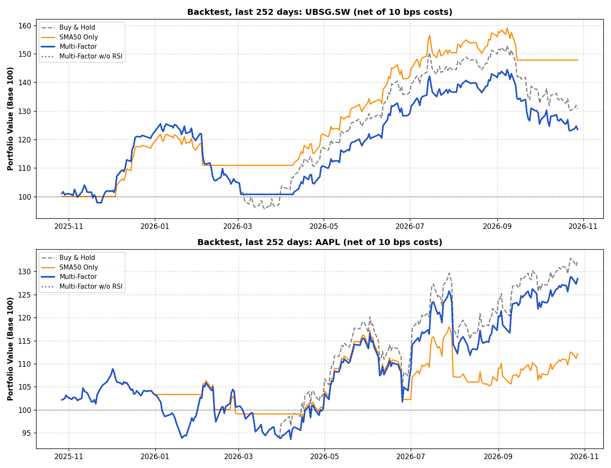

# Financial Data Pipeline, Risk Analyzer & Transparent Backtester (v2.3)

Automated pipeline: **Yahoo Finance -> SQLite -> risk metrics -> backtest -> charts -> this README**,
for Apple (`AAPL`) and UBS Group (`UBSG.SW`). Refreshed daily by GitHub Actions (see `.github/workflows`).
Last updated: 2026-10-28 11:48 UTC.

## What it does

* **ETL:** downloads 10y of daily adjusted prices (`auto_adjust=True`, i.e. splits and dividends included) and stores them in SQLite.
* **Risk metrics (last 252 trading days):** annualised volatility, Sharpe ratio, maximum drawdown, SMA(50/200), Wilder's RSI(14).
* **Backtest:** four rules are compared on identical dates:
  1. `Buy & Hold`
  2. `SMA50 Only`: long while price > SMA(50)
  3. `Multi-Factor`: long while price > SMA(50) OR (price > SMA(200) AND RSI < 65)
  4. `Multi-Factor w/o RSI`: ablation, long while price > SMA(50) OR price > SMA(200). Comparing rows 3 and 4 shows whether the RSI condition adds anything.
* Results are reported for three periods: the **full period**, the **older period** (everything before the last 252 days) and the **last 252 days**.

Backtest data: UBSG.SW: 2017-08-16 to 2026-10-28; AAPL: 2017-08-16 to 2026-10-27.

## Risk & momentum summary (last 252 days)

```
         Latest Price (CCY)  Annual Volatility (%)  Sharpe Ratio  Max Drawdown (%)  SMA (50)  SMA (200)  Wilder's RSI (14)
UBSG.SW               38.48                  24.07          1.19            -23.81     41.37      37.40              38.65
AAPL                 347.10                  23.98          1.21            -13.80    331.06     294.98              61.11
```

## Backtest results (net of 10 bps per position change)

### Full period
```
                              Net Return (%)  Ann. Return (%)  Net Sharpe  Max DD (%)  Trades  In Market (%)
Ticker  Strategy                                                                                            
UBSG.SW Buy & Hold                    224.88            13.70        0.59      -58.22       1         100.00
        SMA50 Only                     62.11             5.41        0.37      -42.74     166          59.04
        Multi-Factor                   91.63             7.35        0.43      -45.90      91          76.38
        Multi-Factor w/o RSI           91.63             7.35        0.43      -45.90      91          76.38
AAPL    Buy & Hold                    822.03            27.40        0.96      -38.52       1         100.00
        SMA50 Only                    243.74            14.41        0.77      -30.88     149          65.96
        Multi-Factor                  459.55            20.65        0.87      -35.83      63          85.42
        Multi-Factor w/o RSI          459.55            20.65        0.87      -35.83      63          85.42
```


### Older period (before the last 252 days)
```
                              Net Return (%)  Ann. Return (%)  Net Sharpe  Max DD (%)  Trades  In Market (%)
Ticker  Strategy                                                                                            
UBSG.SW Buy & Hold                    148.30            11.77        0.53      -58.22       1         100.00
        SMA50 Only                      9.68             1.14        0.15      -42.74     162          59.03
        Multi-Factor                   54.98             5.51        0.35      -45.90      89          74.66
        Multi-Factor w/o RSI           54.98             5.51        0.35      -45.90      89          74.66
AAPL    Buy & Hold                    595.58            26.78        0.93      -38.52       1         100.00
        SMA50 Only                    206.15            14.67        0.78      -30.88     131          65.44
        Multi-Factor                  335.24            19.71        0.83      -35.83      61          83.69
        Multi-Factor w/o RSI          335.24            19.71        0.83      -35.83      61          83.69
```

### Last 252 days (the window in which the Multi-Factor rule was designed)
```
                              Net Return (%)  Ann. Return (%)  Net Sharpe  Max DD (%)  Trades  In Market (%)
Ticker  Strategy                                                                                            
UBSG.SW Buy & Hold                     30.71            30.71        1.23      -23.81       1         100.00
        SMA50 Only                     47.81            47.81        2.26       -9.04       4          59.13
        Multi-Factor                   23.53            23.53        1.06      -19.76       3          90.48
        Multi-Factor w/o RSI           23.53            23.53        1.06      -19.76       3          90.48
AAPL    Buy & Hold                     32.43            32.43        1.29      -13.80       1         100.00
        SMA50 Only                     12.17            12.17        0.67      -12.79      19          70.24
        Multi-Factor                   28.43            28.43        1.17      -14.01       3          99.60
        Multi-Factor w/o RSI           28.43            28.43        1.17      -14.01       3          99.60
```


## Market dashboard


| 1-Month View | 1-Week View |
| :---: | :---: |
|  |  |

## How to run locally

```
git clone https://github.com/seloos/financial-data-analyzer.git
cd financial-data-analyzer
pip install -r requirements.txt
python main.py
```

## Methodology & limitations

* **No look-ahead:** a signal computed at the close of day t is applied to the returns of day t+1 (`shift(1)`).
* **Same dates for everyone:** evaluation starts once SMA(200) exists, so all strategies and Buy & Hold cover identical days.
* **Costs:** 10 bps per position change, including the initial entry. Each period is run as a fresh start (a strategy that is already invested at the start of a period pays the entry cost, like Buy & Hold).
* **Cash earns 0%** and the Sharpe ratio uses a 0% risk-free rate. Taxes are ignored.
* **In-sample warning:** the Multi-Factor rule and its RSI threshold (65) were chosen after looking at the last 252 days, where SMA(50) alone produced many false signals on AAPL. That window is therefore in-sample. The older period is only a rough out-of-sample check, not a clean one, because the author had already seen the price history.
* **Two assets, chosen in hindsight:** this is not statistical evidence of any trading edge. Results can look better or worse than Buy & Hold depending on the period, and the tables above are regenerated from live data on every run.
* **Data:** Yahoo Finance via `yfinance`; no checks for data errors or survivorship effects.
* **Disclaimer:** educational project, not financial advice.
