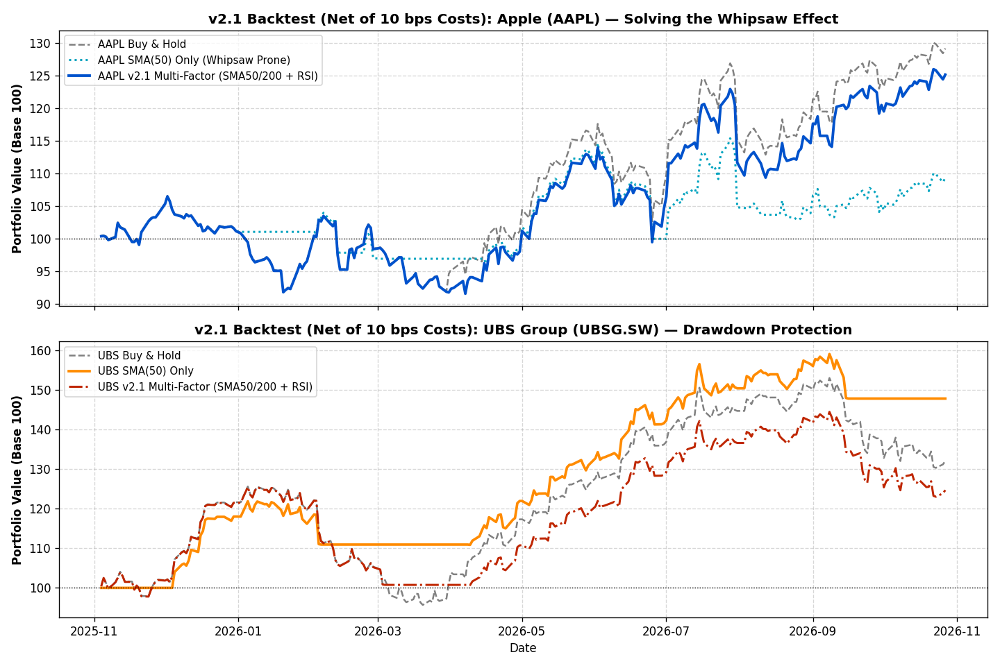
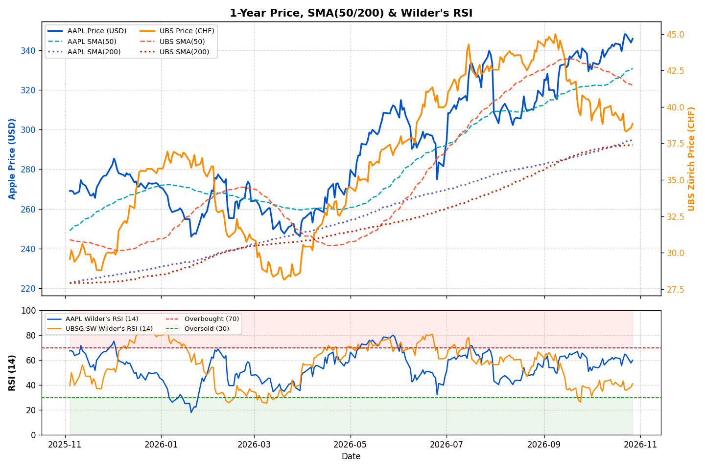
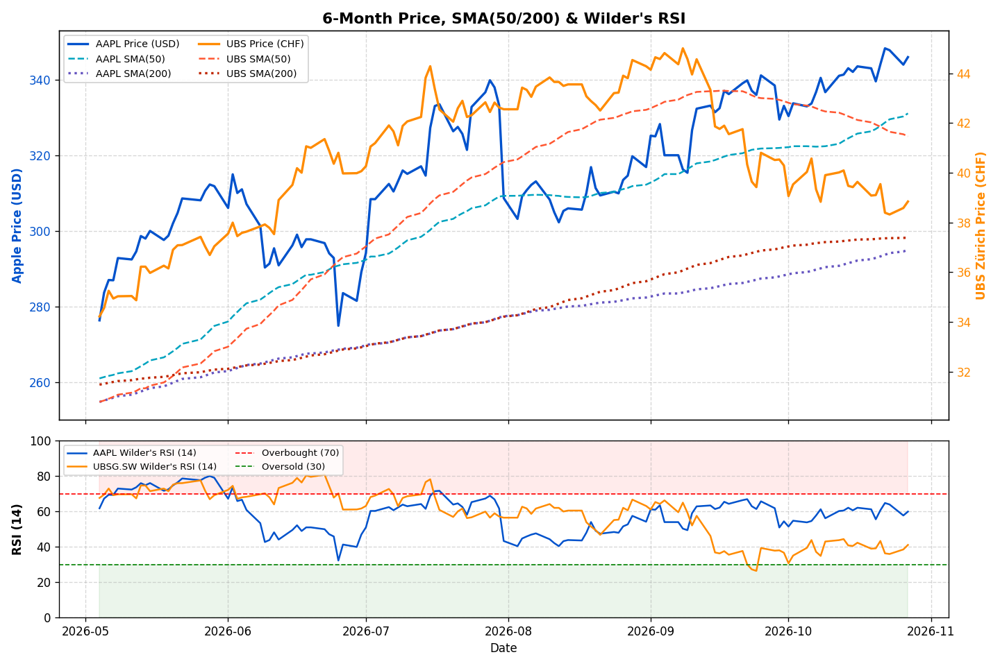
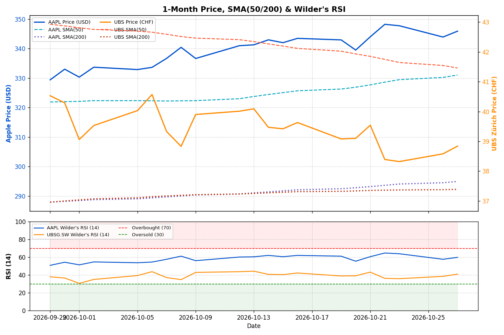
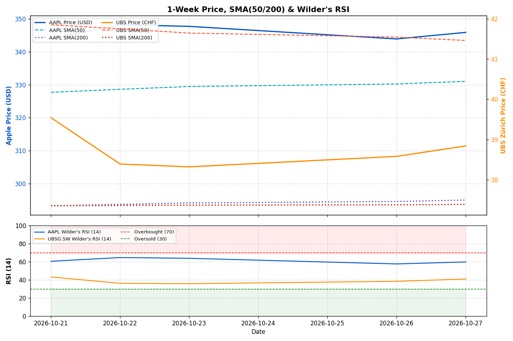

# 📈 Quantitative Financial Data Pipeline, Risk Analyzer & Backtester (v2.1)

An automated end-to-end **ETL (Extract, Transform, Load) pipeline**, quantitative risk analyzer, and vectorized backtesting engine built in Python. This system fetches daily market data for **Apple Inc. (`AAPL`)** and **UBS Group AG (`UBSG.SW`)** via the Yahoo Finance API, computes native-calendar risk/momentum metrics and transaction-cost-adjusted strategy backtests into a local **SQLite** database, and generates daily visualizations via **GitHub Actions**.

---

## 🚀 Key Features & Architecture

* **Automated Cloud CI/CD Pipeline:** Scheduled via GitHub Actions (`cron`) to execute daily at 08:00 UTC, updating the SQLite database, README metrics, and visual dashboards automatically.
* **v2.1 Multi-Factor Backtesting & Transaction Costs:** Compares a single-factor **SMA(50)** trend strategy against a **Multi-Factor Regime Filter (SMA 50/200 + RSI)** designed to eliminate bull-market whipsaws, deducting **10 bps (0.10%)** per trade for realistic slippage and commission modeling.
* **Unbiased Native-Calendar Math:** Computes daily returns, annualized volatility, **Sharpe Ratio**, Wilder's RSI, and moving averages on each exchange's native trading calendar (`NASDAQ` vs. `SIX`) *prior* to visual forward-filling (`ffill`).

---

## 📊 Latest Quantitative Risk & Momentum Summary (1-Year)

```
         Latest Price (CCY)  Annual Volatility (%)  Sharpe Ratio  Max Drawdown (%)  SMA (50)  SMA (200)  Wilder's RSI (14)
UBSG.SW               38.84                  24.07          1.28            -23.81     41.46      37.39              41.04
AAPL                 345.90                  23.97          1.19            -13.80    331.03     294.97              59.89
```

## 🧪 v2.1 Strategy Backtest Comparison (Net of 10 bps Costs, 1-Year)

```
                             Net Return (%)  Net Sharpe  Max DD (%)  Trades
UBSG.SW (Buy & Hold)                  32.07        1.28      -23.81       1
UBSG.SW (SMA50 Only)                  47.81        2.27       -9.04       4
UBSG.SW (v2.1 Multi-Factor)           24.68        1.11      -19.76       3
AAPL (Buy & Hold)                     29.15        1.19      -13.80       1
AAPL (SMA50 Only)                      9.29        0.54      -12.79      19
AAPL (v2.1 Multi-Factor)              25.13        1.07      -14.01       3
```



---

## 📈 Live Automated Market Dashboard

### 1-Year Historical Performance, SMA(50/200) & Wilder's RSI


### 6-Month Medium-Term Trend & Momentum


### 1-Month & 1-Week Short-Term Action
| 1-Month View | 1-Week View |
| :---: | :---: |
|  |  |

---

## ⚙️ How to Run Locally

1. Clone the repository: `git clone https://github.com/seloos/financial-data-analyzer.git`
2. Install dependencies: `pip3 install -r requirements.txt`
3. Run the pipeline: `python3 main.py`

---

## ⚠️ Methodology, Limitations & Disclaimer

* **Look-Ahead Bias Prevention:** Strategy signals generated at Day $t$ market close are executed on Day $t+1$ returns via `signal.shift(1)`.
* **Transaction Cost Modeling:** Every position flip (`0 -> 1` or `1 -> 0`) incurs a **10 bps (0.10%)** cost deducted directly from daily strategy returns.
* **Wilder's Smoothing:** RSI is calculated using J. Welles Wilder's original exponential smoothing (`alpha = 1/14`).
* **Disclaimer:** Built strictly for educational and quantitative engineering demonstration purposes. Does not constitute financial advice.
